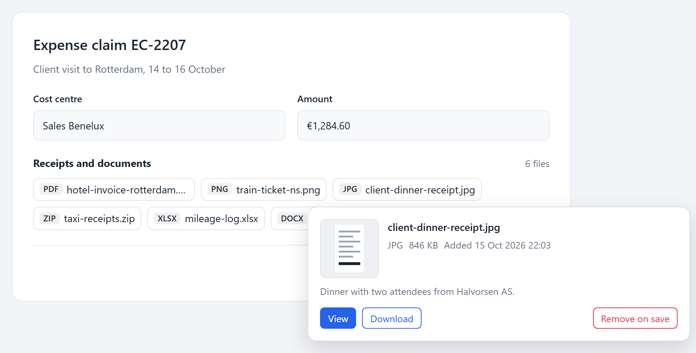
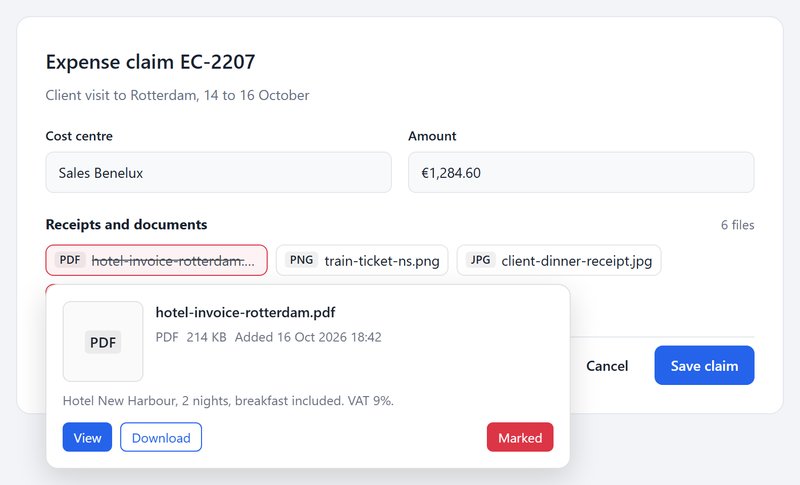
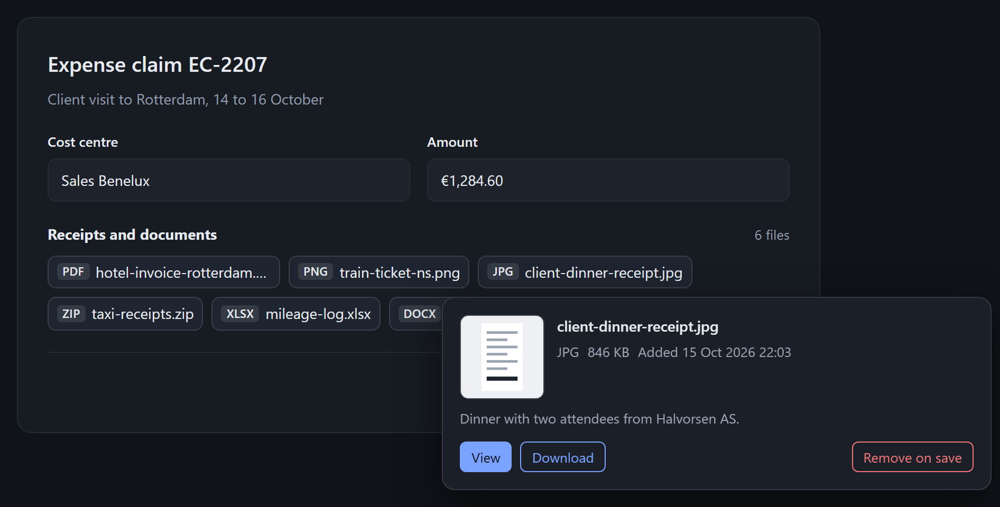

# File Chips

Compact file chips for forms and detail pages. Each chip opens a preview popover with a thumbnail, file details and View / Download links, and can mark the file for removal: a hidden input is added to your form and your server deletes the file on save.



- **JavaScript + CSS** on npm as [`@ozankurt/file-chips`](https://www.npmjs.com/package/@ozankurt/file-chips): no dependencies, no framework, about 3 KB minified.
- **Laravel** on Packagist as `ozankurt/laravel-file-chips`: a `<x-file-chips>` Blade component that renders the markup, with optional [Spatie Media Library](https://spatie.be/docs/laravel-medialibrary) support, and ships the same built JS and CSS.

Both come from this one repository and share one markup contract, so you can use the Blade component, write the markup yourself, or render it from any other backend.

## Laravel

```bash
composer require ozankurt/laravel-file-chips
php artisan vendor:publish --tag=file-chips-assets
```

In your layout:

```blade
<head>
    @fileChipsStyles
</head>
<body>
    ...
    @fileChipsScripts
</body>
```

Both URLs carry the published file's modification time (`?v=...`), so browsers fetch the new files after you upgrade and publish the assets again. The script tag gets your CSP nonce when the app uses `Vite::useCspNonce()`.

In a form:

```blade
<form method="POST" action="{{ route('posts.update', $post) }}">
    @csrf
    @method('PUT')
    <x-file-chips :files="$post->getMedia('attachments')" input="delete_media_ids[]" />
    <button>Save</button>
</form>
```

```php
// Controller
foreach ($request->input('delete_media_ids', []) as $id) {
    $post->media()->whereKey($id)->first()?->delete();
}
```

Always scope the deletion to the owning model as above; the ids come from the browser.

Marking a file adds the hidden input and strikes the chip through until the form is saved:



### Props

| Prop | Type | Default | Description |
|---|---|---|---|
| `files` | iterable of `Media`, `FileChip` or arrays | `[]` | The files to show. Renders nothing when empty. |
| `input` | `string\|null` | `null` | Name of the hidden input that collects ids marked for removal. `null` hides the remove button. |
| `id-prefix` | `string\|null` | derived | Prefix for the popover element ids. By default it is derived from the files and `input`, so it stays the same across re-renders (Livewire, Turbo, htmx). Set it when two lists on one page show the same files. |

Other attributes (`id`, `class`, `data-*`, ...) go onto the wrapper `<div>`.

### Files that are not Media Library models

Pass arrays or `FileChip` objects:

```blade
<x-file-chips :files="[
    ['id' => $doc->id, 'name' => $doc->filename, 'size' => $doc->bytes, 'view_url' => route('docs.show', $doc)],
]" />
```

| Key | Required | Notes |
|---|---|---|
| `id` | yes | Sent back in the removal input |
| `name` | yes | File name shown on the chip |
| `extension` | no | Taken from `name` when missing |
| `mime_type` | no | Used for the category when the extension is unknown |
| `size` | no | Bytes (formatted for you) or a ready string |
| `thumb_url`, `view_url`, `download_url` | no | `download_url` defaults to `view_url`. Only relative, `http(s):` and `blob:` URLs are kept (plus `data:image/...` for thumbnails); `javascript:` and other schemes are dropped. |
| `excerpt` | no | Short text under the details |
| `is_image` | no | Derived from extension and MIME type |
| `created_at` | no | `DateTimeInterface` or a date string |

`FileChip::fromMedia($media)` turns a Media Library model into a chip. S3 disks get temporary URLs; the download link adds a `Content-Disposition: attachment` header that keeps non-ASCII file names. Images browsers cannot show (HEIC, for example) get no thumbnail unless a thumb conversion exists.

### Configuration

```bash
php artisan vendor:publish --tag=file-chips-config
```

| Key | Default | Description |
|---|---|---|
| `asset_path` | `vendor/file-chips` | Where the assets are published |
| `icons` | `null` | Icon classes per category, e.g. `['pdf' => 'far fa-file-pdf', 'file' => 'far fa-file']`. `null` shows an extension badge, so no icon font is needed. |
| `date_format` | `d M Y H:i` | Format of the "Added" date |
| `thumb_conversion` | `thumb` | Media Library conversion used as thumbnail; `null` to skip |
| `temporary_url_minutes` | `30` | Lifetime of temporary S3 view and thumbnail URLs |
| `download_url_minutes` | `15` | Lifetime of temporary S3 download URLs |
| `summary_property` | `summary` | Media custom property shown as excerpt; `null` to skip |
| `summary_limit` | `160` | Excerpt length |

Categories: `pdf`, `image`, `document`, `spreadsheet`, `presentation`, `archive`, `audio`, `video`, `code`, `email`, `file`.

Labels are translatable (`php artisan vendor:publish --tag=file-chips-lang`), and the view can be published with `--tag=file-chips-views`.

## JavaScript only

```bash
npm i @ozankurt/file-chips
```

```js
import FileChips from '@ozankurt/file-chips';
import '@ozankurt/file-chips/style.css';

FileChips.init();
```

Or with script tags (starts automatically when the DOM is ready; add `data-manual` to the `<script>` tag to start it yourself):

```html
<link rel="stylesheet" href="https://cdn.jsdelivr.net/npm/@ozankurt/file-chips@1/dist/file-chips.min.css">
<script src="https://cdn.jsdelivr.net/npm/@ozankurt/file-chips@1/dist/file-chips.min.js" defer></script>
```

### Markup contract

```html
<form>
    <div class="fc-chips" data-file-chips>
        <div data-file-chips-bucket hidden></div>

        <button type="button" class="fc-chip" data-file-chip="doc-12" aria-controls="doc-12" aria-expanded="false">
            <span class="fc-chip__ext">pdf</span>
            <span class="fc-chip__name">contract.pdf</span>
        </button>

        <div id="doc-12" class="fc-popover" data-file-chip-popover hidden>
            <!-- anything you like: thumbnail, details, links -->
            <button type="button" class="fc-btn fc-btn--danger" data-file-chip-remove
                    data-file-chip-id="12" data-file-chip-input="delete_ids[]"
                    data-label-marked="Marked" data-label-unmarked="Remove on save" aria-pressed="false">
                <span data-file-chip-remove-label>Remove on save</span>
            </button>
        </div>
    </div>
</form>
```

| Attribute | On | Meaning |
|---|---|---|
| `data-file-chips` | container | Groups chips; its bucket receives the hidden inputs |
| `data-file-chips-bucket` | optional element in the container | Where hidden inputs go; the closest `<form>` is used when missing |
| `data-file-chip="<id>"` | chip | Opens the popover with that element id |
| `data-file-chip-popover` | popover | Start it with `hidden` |
| `data-file-chip-remove` | button in the popover | Toggles the mark; needs `data-file-chip-id` and `data-file-chip-input` |
| `data-file-chip-remove-label` | element in the button | Text swapped between `data-label-marked` and `data-label-unmarked` |

Keep each popover right after its chip. Popovers stay where they are in the DOM and use `position: fixed`, so they follow the chip in tab order, inherit the CSS variables of their container, and disappear with it when the page re-renders. They flip above the chip when there is no room below, and their position is corrected when a transformed ancestor (for example an animated modal) moves the fixed origin. Outside click and Escape close them; Escape returns focus to the chip.

### API

| Call | Description |
|---|---|
| `FileChips.init({ root = document })` | Start handling chips inside `root`. A root that is already handled, itself or through an ancestor, is a no-op, so several roots and the script build's automatic start can coexist. Returns a function that stops handling that root. |
| `FileChips.open(chip)` | Open a chip's popover; returns the popover or `null` |
| `FileChips.close()` | Close the open popover |
| `FileChips.getOpen()` | The open popover or `null` |
| `FileChips.position(chip, popover)` | Re-place a popover next to its chip |

Marking and unmarking dispatch a bubbling `file-chips:change` event on the chip with `detail: { id, input, marked }`. The chip gets `fc-chip--marked` and the button `fc-btn--active` plus `aria-pressed="true"` while marked.

## Styling

Every colour, radius and size is a CSS custom property. Override them on `:root` or on any wrapper around the chips (popovers inherit them too):

```css
.dark {
    --fc-chip-bg: #1f2937;
    --fc-chip-bg-hover: #273244;
    --fc-border: rgba(255, 255, 255, 0.12);
    --fc-popover-bg: #111827;
    --fc-popover-border: rgba(255, 255, 255, 0.12);
    --fc-muted: #9ca3af;
    --fc-thumb-bg: #1f2937;
}
```



Full list: `--fc-font-size`, `--fc-gap`, `--fc-radius`, `--fc-chip-max-width`, `--fc-chip-bg`, `--fc-chip-bg-hover`, `--fc-border`, `--fc-text`, `--fc-muted`, `--fc-danger`, `--fc-danger-bg`, `--fc-primary`, `--fc-primary-text`, `--fc-focus`, `--fc-ext-bg`, `--fc-popover-width`, `--fc-popover-bg`, `--fc-popover-border`, `--fc-popover-radius`, `--fc-popover-shadow`, `--fc-popover-z`, `--fc-thumb-size`, `--fc-thumb-bg`.

## Development

```bash
npm install && composer install
npm test            # JS (Vitest + happy-dom)
vendor/bin/pest     # PHP
npm run build       # rebuild dist/, which is committed
npm run examples    # the showcase on http://localhost:5183/showcase.html
npm run screenshots # recapture docs/images/ from the showcase
npm run typecheck   # the TypeScript declarations
```

CI runs the PHP suite on PHP 8.3 and 8.4 with Laravel 12, and PHP 8.4 with Laravel 13, plus the JS tests, the typecheck and a check that the committed `dist/` matches the sources.

### TypeScript

`dist/file-chips.d.ts` types the JS API and the `file-chips:change` event, so `import FileChips from '@ozankurt/file-chips'` is typed in TypeScript and editors.

The showcase takes `?scheme=light|dark` and `?scene=popover|marked`.

## License

MIT
